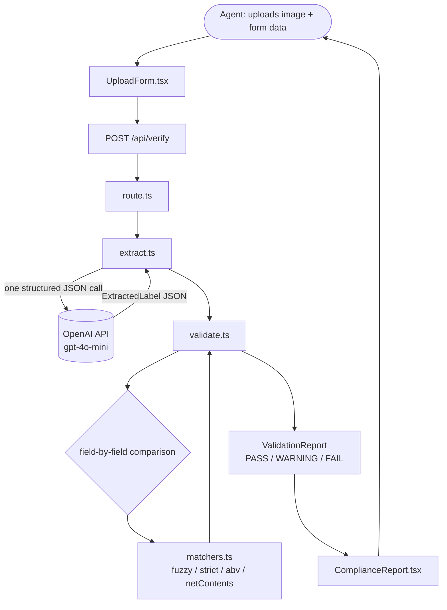

# TTB Label Verification

An AI-powered prototype that helps compliance agents verify alcohol beverage labels against COLA (Certificate of Label Approval) application data. Upload a label image and enter the application details — the app reads the label with GPT-4o-mini vision, checks every required field, and returns a pass/fail compliance report in around 3–5 seconds.

Built as a take-home project against the [TTB instructions](https://github.com/treasurytakehome-rgb/instructions).

---

## What it checks

Each submission the label review involves matching what is printed on the label against what the applicant declared on the application form. This tool automates that matching step.

| Stakeholder concern | How this app addresses it |
|---|---|
| "If we can't get results back in about 5 seconds, nobody's going to use it" — Sarah | Single GPT-4o-mini vision call extracts all fields at once. No chaining, no polling. Deterministic validation runs in < 1 ms after extraction. |
| "Something my mother could figure out" — Sarah | Two-step numbered form. Drag-and-drop image upload with preview. Large type, high-contrast results. No menus to hunt through. |
| "STONE'S THROW vs Stone's Throw — obviously the same thing" — Dave | Brand name, class/type, and bottler use fuzzy matching (Levenshtein ≥ 85% after normalization). Case and punctuation variations pass automatically. |
| "The warning statement has to be exact. Word-for-word." — Jenny | Government Warning uses strict comparison. "GOVERNMENT WARNING:" prefix must be all caps or the field fails. Near-identical OCR variance (≥ 99% normalized similarity) shows as PASS; 95–99% shows as WARNING for manual review. |
| Agents with very different tech comfort levels — Sarah | Three-state verdicts: PASS / WARNING / FAIL. Tool recommends; agent decides. No hidden scores. |

---

## Architecture



### Why this architecture

**One AI call, then deterministic code.** GPT-4o-mini extracts all label fields in a single structured JSON call. Every pass/fail decision after that is made by plain TypeScript with no model involvement — so compliance rules are auditable, adjustable without re-prompting, and unit-testable in isolation.

**No microservices.** The entire app is a Next.js project: one `npm run dev`, one deployment unit. A separate FastAPI service, message queue, or vector database would add operational complexity with zero benefit at prototype scale.

**No persistence.** Label images and extracted text exist only for the duration of a request. Nothing is written to disk or a database — consistent with the prototype scope and FedRAMP data handling considerations raised by Marcus (IT).

---

## Matching rules

The key engineering judgment in this project is *which fields get fuzzy matching and which get strict matching*:

| Field | Strategy | Rationale |
|---|---|---|
| Brand Name | Fuzzy — Levenshtein ≥ 85% | Dave's "STONE'S THROW" / "Stone's Throw" case. Stylization is common; obvious mismatches still fail. |
| Class / Type | Fuzzy — Levenshtein ≥ 85% | Minor wording variants ("Bourbon Whiskey" vs "Straight Bourbon Whiskey") surface as WARNING. |
| ABV | Numeric extraction, ± 0.5% tolerance | Parses percentage from both expected and extracted (including proof conversion ÷ 2). "45% Alc./Vol." matches "45%". |
| Net Contents | Unit-normalized exact | Normalizes mL / ml / milliliter, fl. oz / floz, L / liter before comparing. |
| Bottler / Producer | Fuzzy — Levenshtein ≥ 85% | Address formatting varies; name similarity is what matters. |
| Country of Origin | Fuzzy — Levenshtein ≥ 85% | Only checked when the application declares an import. |
| Government Warning | Strict | Jenny's requirement: word-for-word. "GOVERNMENT WARNING:" prefix must be all caps (title case = hard FAIL). OCR whitespace/punctuation variance within 99% normalized similarity is treated as PASS to avoid false positives from AI extraction noise. 95–99% → WARNING for human review. |

---

## Project structure

```
TTB-LabelVerification/
├── app/
│   ├── api/verify/route.ts     POST endpoint: receives image + appData, returns report
│   ├── layout.tsx              App shell and header
│   └── page.tsx                Server entry point
├── components/
│   ├── VerificationApp.tsx     Client-side state management and fetch logic
│   ├── UploadForm.tsx          Drag-drop image upload + application data form
│   └── ComplianceReport.tsx    Field-by-field results table, overall verdict banner
├── lib/
│   ├── extract.ts              GPT-4o-mini vision call → ExtractedLabel JSON
│   ├── validate.ts             Field-by-field comparison engine
│   └── matchers.ts             fuzzyMatch · strictMatch · abvMatch · netContentsMatch
├── types/
│   └── label.ts                Shared TypeScript interfaces
├── tests/
│   ├── run-tests.mjs           8-label smoke test runner (requires dev server)
│   ├── labels/                 50 synthetic test label images (gitignored)
│   └── batch_mixed.csv         Application data for all 50 labels (gitignored)
│                               Test assets sourced from github.com/zukeoh/treasury-take-home
├── .env.local.example
└── next.config.mjs
```

---

## Quick start

```bash
git clone <your-repo-url>
cd TTB-LabelVerification
npm install

cp .env.local.example .env.local
# Open .env.local and paste your OpenAI API key
# Get one at: https://platform.openai.com/api-keys

npm run dev
# → http://localhost:3000
```

**Requirements:** Node.js 18+, an OpenAI API key (GPT-4o-mini access).

---

## Running the smoke tests

The test suite covers 8 label scenarios — one per failure category — and requires the dev server running.

Test labels and application data are sourced from [zukeoh/treasury-take-home](https://github.com/zukeoh/treasury-take-home/tree/main/tests/resources/sample_data) (50 synthetic TTB fixtures: 18 PASS, 5 FAIL, 27 NEEDS REVIEW).

```bash
# In one terminal:
npm run dev

# In another:
node tests/run-tests.mjs
```

Expected output:

```
[1/8] old_tom_distillery.png          (3s)   PASS  ✓ correct  — clean reference label
[2/8] stones_throw_case_variation.png (3s)   PASS  ✓ correct  — fuzzy match handles case
[3/8] north_point_wrong_abv.png       (3s)   FAIL  ✓ correct  — ABV 45% vs 40% caught
[4/8] hilltop_wrong_net_contents.png  (4s)   FAIL  ✓ correct  — net contents mismatch
[5/8] red_ridge_missing_warning.png   (4s)   FAIL  ✓ correct  — missing warning detected
[6/8] sol_y_mar_missing_country.png   (4s)   FAIL  ✓ correct  — missing country of origin
[7/8] midnight_vodka_blurry.png       (4s)   PASS  ✓ correct  — blurry image still readable
[8/8] jade_dragon_flipped.png         (4s)   —               — see Known Limitations

7/8 matched expected outcome   avg ~3s per label
```

The 2-second inter-request delay in the test runner avoids hitting the 60k TPM rate limit on OpenAI's Tier 1 accounts. In production at higher usage tiers, all 8 tests run in parallel without delay.

---

## Deploying to Vercel

```bash
# 1. Push to GitHub
git push origin main

# 2. vercel.com → Add New Project → import this repo
#    Framework is auto-detected as Next.js — no settings needed

# 3. Environment Variables → add OPENAI_API_KEY

# 4. Deploy
```

---

## Assumptions and trade-offs

**External API dependency.** The app calls the OpenAI API over the public internet. Marcus (IT) flagged that the agency network blocks outbound traffic to many domains. A production deployment would need the AI model hosted within the agency's own Azure environment, or the OpenAI API endpoint allowlisted in the firewall. This prototype treats that as out of scope.

**No auth.** Out of scope for a prototype; a production version would integrate with agency SSO (likely Azure AD).

**No COLA integration.** The discovery notes are explicit that this is a standalone proof-of-concept, not wired into the existing .NET COLA system.

**No persistent storage.** Nothing is written to disk or a database. Images and extracted data exist only in memory for the duration of the request. Consistent with the "no PII storage for the prototype" guidance from Marcus.

**Field extraction accuracy depends on the vision model.** GPT-4o-mini reads imperfect photos (angled, blurry, glare) significantly better than classical OCR, but it can still fail on severely degraded images. The extraction notes field surfaces AI confidence issues. Unreadable labels should be rejected and re-submitted as they are today.

**Free-tier data usage.** OpenAI's default API tier may use inputs to improve models. For a production deployment handling real applicant data, the paid tier (which opts out) or an on-premises model would be required.

**Batch upload not implemented.** Sarah and Janet mentioned processing 200–300 label batches. The single-label verification function is isolated behind a clean interface (`extractLabelData` + `validateLabel`) and designed to be called in a loop. Batch mode is the most valuable next feature.

---

## Known limitations

- **Severely oriented images** (upside-down, flipped): GPT-4o-mini may misread some fields, particularly the bottler address. `jade_dragon_flipped.png` demonstrates this. A pre-processing step (auto-rotation correction) would improve accuracy.
- **Rate limits on OpenAI Tier 1** ($5–$50 spend): 60k tokens/minute. The test runner includes automatic retry with exponential backoff (8s, 16s). In production with higher spend tiers or a self-hosted model, this is not a concern.
- **Bold detection**: Jenny specified the warning must be bold. Text extraction cannot reliably detect font weight; this is noted in the UI as a limitation agents should verify visually.
- **Proof-only labels**: Some labels show only proof (e.g. "80 Proof") without a percentage. The ABV matcher converts proof ÷ 2 to a percentage for comparison. Labels showing only proof with no percentage equivalent may need manual review.

---

## Evaluation criteria mapping

| Criterion | Where to look |
|---|---|
| Correctness and completeness | `lib/validate.ts` · `lib/matchers.ts` · test results above |
| Code quality and organization | `lib/` layer is pure TypeScript with no side effects · types are centralized in `types/label.ts` |
| Appropriate technical choices | Next.js monolith over microservices · single AI call over agentic chains · gpt-4o-mini over gpt-4o for cost and speed |
| User experience | `components/UploadForm.tsx` · large type, numbered steps, drag-drop, pre-populated warning text |
| Attention to requirements | Matching rules table above maps directly to stakeholder quotes |
| Creative problem solving | Tri-state WARNING status for near-matches · proof-to-percentage conversion · per-field retry backoff |
